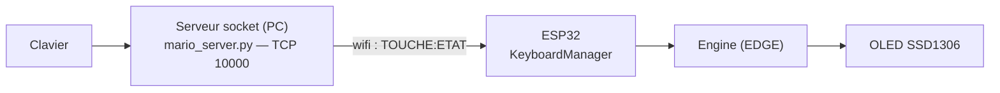

# mario-esp32 — Conception

## Contexte technique

ESP32 + écran OLED SSD1306, moteur de jeu **EDGE**
(<https://github.com/nbourre/ESP32-Game-Engine>). 

Les commandes viennent du clavier d'un PC, relayées en WiFi/TCP par `mario_server.py`.

Architecture réseau :



Le PC écoute (serveur, port TCP `10000`) et envoie chaque touche en texte (`TOUCHE:ETAT\n`). L'ESP32 est le client : il se connecte au WiFi puis au serveur, lit les touches et fait tourner le jeu.

---

## Structure de projet cible

```
src/
├─ MyGameScene.*              charge la map, instancie les actors, caméra, game over
├─ GameLayers.h               couches de collision (bitmask)
├─ World/
│  ├─ TileMap.*               grille de tuiles -> génère les blocs
│  ├─ Camera.*                suit le joueur, convertit monde->écran, ignore le hors-champ
│  └─ Background.*            décor non collidable : hill, bush, clouds
├─ Actors/
│  ├─ PlayerActor.*           
│  ├─ Enemies/
│  │  ├─ EnemyActor.*        
│  │  ├─ Goomba.*
│  │  └─ Koopa.*              
│  ├─ Items/
│  │  ├─ ItemActor.*          
│  │  ├─ Mushroom.*
│  │  └─ OneUp.*
│  └─ Blocks/
│     ├─ BlockActor.*         
│     ├─ BreakableBlock.*
│     ├─ MysteryBlock.*       
│     ├─ UnbreakableBlock.*
│     └─ Pipe.*
├─ Managers/
│  ├─ KeyboardManager.*       client WiFi
│  └─ PlayerPhysicsManager.*  physique du joueur
└─ Assets/
   └─ Sprites.h               bitmaps
```

---

## Intégration de chaque feature

### Caméra — `World/Camera.*`
Service de scène, pas un Actor. Elle calcule un offset à partir de la position du
joueur. Au `draw()`, la scène décale les coordonnées monde -> écran via la caméra
et **ne dessine pas** ce qui tombe hors de la zone visible (culling). Remplace le
rendu « plein écran » actuel de `MyGameScene`.

### Map matrice — `World/TileMap.*`
Une grille 2D d'identifiants de tuiles (vide / sol / bloc...). Au chargement, la
TileMap **instancie les Actors** correspondants (`BlockActor` et dérivés) sur la
couche `SOLID`. C'est la source de vérité du niveau ; la caméra et la physique
s'y réfèrent.

### Physique vs map
Aujourd'hui `PlayerPhysicsManager` ne collisionne qu'avec les bords de l'écran.
Avec la TileMap, il devra tester la collision contre les tuiles solides autour du
joueur (résolution axe par axe). C'est une évolution interne au manager, l'API
`step(...)` ne change pas.

### Interactibles — `Actors/`
Tous sont des `Actor` avec une couche de collision ; la réaction se fait dans
`onCollision`.

- **Ennemis** (`Enemies/`) : `EnemyActor` (couche `ENEMY`) gère le déplacement et
  la mort au stomp. `Goomba`, `Koopa` ne font que spécialiser le comportement.
- **Bonus** (`Items/`) : `ItemActor` (nouvelle couche `ITEM`), apparaît, se
  déplace éventuellement, applique un effet au contact du joueur (`Mushroom`,
  `OneUp`).
- **Blocs** (`Blocks/`) : `BlockActor` (couche `SOLID`). `MysteryBlock` libère un
  `ItemActor` quand frappé par en dessous, `BreakableBlock` disparaît,
  `UnbreakableBlock` ne réagit pas, `Pipe` est un gros bloc solide.

### Environnement — `World/Background.*`
Hill, bush, clouds : **décor pur**, aucune collision. Dessiné par la caméra en
premier (arrière-plan), avant les actors.

### Game over — dans `MyGameScene`
Un état de la scène. Quand le joueur meurt (ennemi / chute hors écran), la scène
bascule en état « game over » (afficher un écran, figer l'update, permettre un
restart). Pas de nouveau fichier nécessaire au début.

### Bitmaps — `Assets/Sprites.h`
Les sprites (tableaux de pixels) y sont centralisés. Chaque `draw()` d'Actor
remplace son rectangle plein par un `drawBitmap`. Les tuiles de la TileMap et le
décor piochent aussi dedans.

## Gestion des problèmes

- **États des touches (GetKey / GetKeyDown / GetKeyUp)** : le serveur n'envoie
  que des fronts `1`/`0`. Pour distinguer « maintenu » de « vient d'être
  pressé/relâché », le `KeyboardManager` garde l'état de la frame précédente
  (`_prev`) en plus de l'état courant (`_held`) et compare les deux à chaque
  `update()`.
- **Intégrer la physique custom au moteur** : la physique est isolée dans
  `PlayerPhysicsManager` (indépendant du moteur et du clavier). Le `PlayerActor`
  fait le pont : dans son `update()`, il construit un `PlayerInput` depuis le
  clavier, récupère les bornes du monde via le `Renderer`, puis appelle
  `physics.step(...)`.
- **Rendre une map plus grande que l'écran** *(non résolu)* : l'OLED ne fait que
  128×46 px alors qu'un niveau est bien plus large. Il faudra une **caméra** qui
  suit le joueur et ne dessine que la portion visible (voir *Caméra* /
  *Map matrice* plus haut).

---

## Annexes

### Librairies

- **EDGE** (ESP32-Game-Engine) : moteur de jeu + rendu OLED (scene, entities,
  renderer, collisions).
- **WiFi** (cœur ESP32) : connexion réseau du `KeyboardManager`.
- **keyboard** (Python, côté PC) : capture du clavier dans `mario_server.py`.

### Divers

- LLM utilisé : Cursor
  - Physique
  - Rédaction documentation

### Références

- Moteur EDGE : <https://github.com/nbourre/ESP32-Game-Engine>
- Physique Mario : <https://web.archive.org/web/20130807122227/http://i276.photobucket.com/albums/kk21/jdaster64/smb_playerphysics.png>
- Carte niveau 1-1 : <https://nesmaps.com/maps/SuperMarioBrothers/SuperMarioBrosMap1-1.png>
